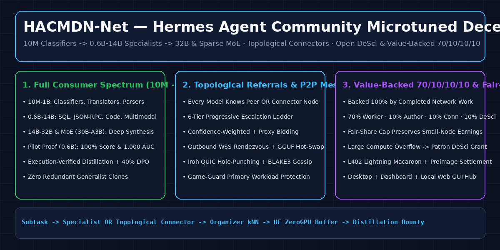
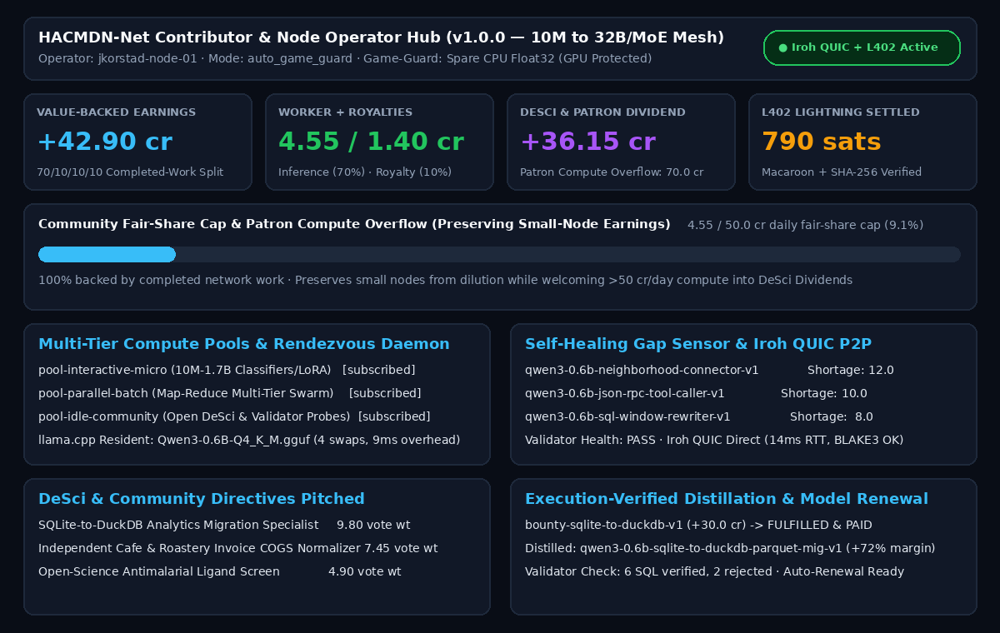

## Summary

Adds **`hacmdn`** (**HACMDN-Net — Hermes Agent Community Microtuned Decentralized Node Network**, `v1.0.0`) to `plugin-catalog/hacmdn.yaml`.

Instead of routing every task to a monolithic frontier LLM or running 100 identical copies of the same generalist model, **HACMDN-Net** (**H**ermes **A**gent **C**ommunity **M**icrotuned **D**ecentralized **N**ode **Net**work) coordinates a self-organizing neighborhood mesh of **laser-focused niche specialists across the entire consumer-grade spectrum (`10M` classifiers/translators $\rightarrow$ `0.6B–14B` micro-models $\rightarrow$ `32B` dense & sparse MoE models with small active parameter footprints)** across modalities:
1. **Multi-Tier Specialization & Pilot Proof-of-Work:** Even a tiny classifier or translation model on a laptop can execute an efficient subtask inside a larger DeSci or community workflow. In our held-out pilot benchmark (`data/pilot_eval_results.json`) testing the `0.6B` micro-tier, all 3 fine-tuned `Qwen/Qwen3-0.6B` LoRA specialists achieved **100% held-out accuracy** (vs `0%–30%` untouched base), **100% OOD abstention**, and **1.0000 ROC-AUC** while running on spare CPU threads alongside an active GPU workload.
2. **Topological Referral, Neighborhood Connectors & 6-Tier Escalation:** Every model either knows the exact specialist to refer a project/subtask to, OR knows a **Neighborhood Connector (`Model #1`)** or **Organizer Super-Peer** with richer topological contacts up a **6-Tier Escalation Ladder** (failing over to the live **Hugging Face ZeroGPU Buffer Space** [`jkorstad/hacmdn-community-buffer`](https://huggingface.co/spaces/jkorstad/hacmdn-community-buffer) when P2P nodes are offline).
3. **Self-Healing Mesh, Missing-Expertise Sensing & Execution-Verified Distillation (`training/distill_specialist.py`):** The network senses where missing expertise lies (via abstention telemetry and Shortage Scores) and recommends targeted fine-tunes trained as soon as enough community compute is dedicated. Validators run ongoing health checks, 5% sampling audits, and rolling benchmarks to phase out stale models and re-distill specialists onto newer base model releases or fresh data using deterministic execution verifiers (`sqlite3`/DuckDB, JSON-RPC schema, Python AST) + a **40% Hard-Negative/OOD Boundary DPO curriculum**.
4. **Value-Backed 70/10/10/10 Attribution, Fair-Share Cap & Patron Compute Overflow + L402 Settlement:**
   - All earnings are **100% backed by the value of verified work actually completed by the network** and distributed **70% Executing Worker / 10% Specialist Author Royalty / 10% Connector / 10% DeSci & Community Pool**.
   - **Community Fair-Share Cap (`50.0 cr/day`) & Patron Overflow:** Preserves the earning power of low-compute contributors against dilution while welcoming large-scale compute above `50.0 cr/day` as a **Community Patron & DeSci Compute Grant** that flows into shared community dividends and open science.
   - **L402 Lightning Settlement:** Settles accumulated credits & cooperative dividends into cryptographic L402 macaroons (`HMAC-SHA256` caveats) + `SHA-256` preimage commitments and BOLT11 invoices.

---

## Hermes Surfaces Used

- **7 LLM Tools (`toolset="hacmdn"` via `ctx.register_tool`):**
  - `hacmdn_route_query`
  - `hacmdn_publish_specialist`
  - `hacmdn_bid_task`
  - `hacmdn_bounty_flywheel`
  - `hacmdn_network_status`
  - `hacmdn_worker_pool`
  - `hacmdn_contributor_hub`
- **In-Session Slash Command (`ctx.register_command`):** `/hacmdn [status|hub|pools|rendezvous|p2p|distill|l402|pitch|route|bid|bounties|vote|idle]`
- **CLI Subcommand (`ctx.register_cli_command`):** `hermes hacmdn <subcommand>`
- **Bundled Skill (`ctx.register_skill`):** `hacmdn-network` (`skills/hacmdn-network/SKILL.md`)
- **Hermes Desktop Native Plugin (`desktop/plugin.js`):** Built strictly with `@hermes/plugin-sdk` and `react/jsx-runtime` (`PANES_AREA` right-docked **HACMDN Hub** pane + `STATUSBAR_AREAS.right` telemetry chip).
- **Hermes Web Dashboard Extension (`dashboard/`):** `dashboard/manifest.json`, `dashboard/plugin_api.py` (`APIRouter` using `asyncio.to_thread`), and `dashboard/dist/index.js` (`window.__HERMES_PLUGIN_SDK__` IIFE).
- **Public Core Imports Only:** Uses `plugins.plugin_storage.plugin_db("hacmdn")` for profile-scoped SQLite storage and `agent.secret_scope.get_secret("HF_TOKEN")` for optional Hugging Face token access.

---

## Rule 13 Disclosure

- **Local Storage:** Stores neighborhood capability descriptors, fine-tuning bounties, work queues, P2P blob metadata, and attribution receipts in a profile-scoped SQLite database via `plugins.plugin_storage.plugin_db("hacmdn")` (`~/.hermes/plugin-data/hacmdn/data.db`). Writes HTML preview widgets and synthetic distillation curricula to `~/.hermes/cache/scratch/`.
- **System Reads:** Reads `/proc/meminfo` on Linux to inspect available RAM for Game-Guard hardware profiling (`network.py`).
- **Credentials:** Optional `HF_TOKEN` is declared as `type: secret` in `plugin.yaml` and read exclusively via `agent.secret_scope.get_secret("HF_TOKEN")`. No `.env` files, `auth.json`, keychains, or external credential stores are read.
- **Network / Local Servers:** Core routing, bidding, distillation verification, and ledger tools run deterministically against the local SQLite coordinator with zero unsolicited network egress. The dashboard extension mounts `/api/plugins/hacmdn/{hub,action,rendezvous}` inside the Hermes dashboard; `hermes hacmdn gui --serve` starts a loopback-only HTTP server on `127.0.0.1:8765` only when explicitly invoked by the user. No telemetry, no self-updating code, and no binary weights shipped in the plugin repository (verified LoRA adapters live on Hugging Face under [`jkorstad/hacmdn-net-hermes-community-microtuned-specialist-network`](https://huggingface.co/collections/jkorstad/hacmdn-net-hermes-community-microtuned-specialist-network-6aef78f6e0ea208136c602e5)).

---

## Screenshots

---

## Validation

- [x] `python3 scripts/validate_plugin_catalog.py plugin-catalog/hacmdn.yaml` → `OK: 1 file(s) valid`
- [x] `hermes plugins validate --install-deps` on clean clone at `b06a1484f1f0bd7652303d23976a892aa1dc418c` → `Validation passed` (`✓ security scan — safe`, `✓ no core override`, `✓ desktop surface`)
- [x] `python3 scripts/scan_plugin_payloads.py` → `0` findings (clean source-only tree)
- [x] `hermes plugins doctor --ci` → `OK (7 tools registered)`
- [x] `pytest tests/` → `10 passed in 0.32s`
